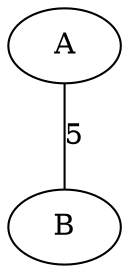

# Graphviz in Markdown (Inline, Light + Dark)

Write Graphviz code **inside your Markdown file**. A GitHub Action finds each block, renders it to a transparent SVG, and commits it to `diagrams/`. Your Markdown then shows the SVG.

No separate `.dot` files needed.


---

## Project structure

```
graphviz-diagrams/
├── .github/
│   ├── workflows/render-graphviz.yml   # the GitHub Action
│   └── scripts/render_dot.py           # finds and renders inline blocks
├── diagrams.md                         # EDIT THIS: inline dot code lives here
├── diagrams/                           # GENERATED SVGs (do not edit)
├── docs/cheatsheet.md                  # color palettes and style tokens
└── README.md                           # this guide
```

---

## How it works

1. You edit the `dot` code block in `diagrams.md` (or any other `.md` file) and push.
2. The Action finds every block whose **first line** is `// graphviz: NAME`.
3. It renders each one to `diagrams/NAME.svg` and commits it.
4. Your Markdown shows the SVG through a normal image line.

The Action only runs when a `.md` file changes, so its own commits never trigger it again. You can also run it manually from the **Actions** tab.

---

## The block syntax

The first line inside the code block names the output file. Wrapping the block in a callout is optional, but it keeps the source tidy under the image.

````markdown


> [!NOTE]
> **Source**
>
> ```dot
> // graphviz: my-graph
> graph G {
>     A -- B [label=5];
> }
> ```
````

You can also use a plain code block without the callout:

````markdown

````

Rules:

- The first line must be exactly `// graphviz: NAME`. Use letters, numbers, `-` and `_` only.
- Each name must be unique within a file.
- The SVG is saved in a `diagrams/` folder next to the Markdown file.
- `README.md` and everything in `docs/` are skipped, because they contain syntax examples. To change this, edit `SKIP_FILES` and `SKIP_DIRS` in `.github/scripts/render_dot.py`.

---

## How to use: one mode or both

`diagrams.md` already contains three versions of the same graph:

| Name | Best for |
|---|---|
| `graph-light` | Light backgrounds |
| `graph-dark` | Dark backgrounds |
| `graph-neutral` | Both (solid indigo nodes, mid-tone colors) |

### Both modes (recommended)

Light viewers see the light version and dark viewers see the dark version.

**Markdown only:**

```markdown


```

**With `<picture>`** (works on GitHub and most other renderers):

```html
<picture>
  <source media="(prefers-color-scheme: dark)" srcset="diagrams/graph-dark.svg">
  
</picture>
```

You need both blocks (`graph-light` and `graph-dark`) in your Markdown.

### Light mode only

Keep only the `graph-light` block, and use:

```markdown

```

### Dark mode only

Keep only the `graph-dark` block, and use:

```markdown

```

### One image for both themes

Keep only the `graph-neutral` block, and use:

```markdown

```

> If you remove a block, also delete its SVG from `diagrams/`. The Action does not delete old SVGs.

---

## Add your own diagram

1. Open `diagrams.md` (or create a new `.md` file anywhere except `README.md` and `docs/`).
2. Copy a block, change the name on the first line, and edit the nodes and edges.
3. Add an image line pointing to `diagrams/<name>.svg`.
4. Push, and the SVG appears after the Action finishes.

For two themes, copy the light and dark blocks and give them matching names, such as `my-graph-light` and `my-graph-dark`.

### Change colors

Edit the hex codes in `fillcolor`, `color`, `fontcolor` and the `edge` line. Ready-made palettes (Indigo, Emerald, Mono, Rose) are in `docs/cheatsheet.md`.

### Highlight a path or MST

```dot
A -- D [xlabel="5", color="#dc2626", penwidth=4];
```

---

## Preview locally (optional)

Install Graphviz and Python, then run from the project root:

```bash
python3 .github/scripts/render_dot.py
```

Or paste the dot code (without the first comment line) into https://dreampuf.github.io/GraphvizOnline

---

## Troubleshooting

| Problem | Fix |
|---|---|
| Image is broken right after a push | Wait a minute for the Action to finish, then refresh. |
| Action fails with a permission error | Go to **Settings → Actions → General → Workflow permissions** and select **Read and write permissions**. |
| Action never runs | Check that the hidden `.github` folder uploaded, and that Actions is enabled in the **Actions** tab. |
| A block is not rendered | The first line inside the code block must be exactly `// graphviz: NAME`, with no blank line before it. |
| Action fails with a render error | The log shows the Graphviz error and the block name. Usually it's a missing `;` or an unclosed quote. |
| Block inside a callout is ignored | Keep the `>` on every line, including blank lines. |
| Weights hard to read | Raise `fontsize` in the `edge` line, or switch `xlabel` to `label` to put the weight on the line. |
