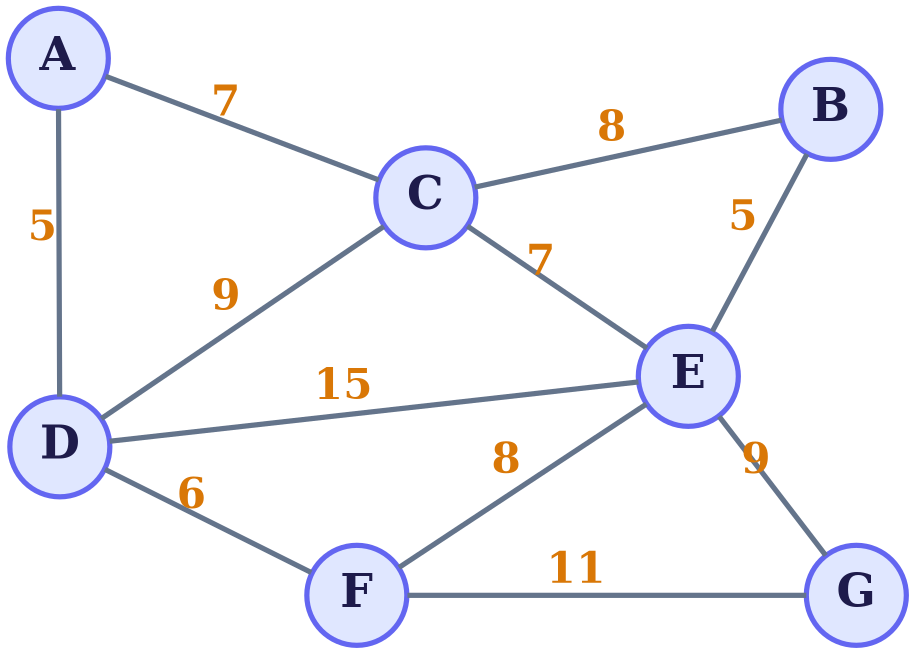

# Graphviz

![Graphviz diagram][graph]

> [!NOTE]
>
> ```dot
> // graphviz: graph
> graph G {
>     layout=neato;
>     bgcolor=transparent;
>     forcelabels=true;
>
>     node [shape=circle, fixedsize=true, width=0.66,
>           fontname="Times-Bold", fontsize=22,
>           style=filled, fillcolor="#1e293b", color="#818cf8",
>           fontcolor="#e0e7ff", penwidth=2.5];
>     edge [color="#94a3b8", penwidth=2.5,
>           fontname="Times-Bold", fontsize=20, fontcolor="#fbbf24"];
>
>     A [pos="1.21,4.35!"];
>     B [pos="6.36,4.01!"];
>     C [pos="3.66,3.42!"];
>     D [pos="1.22,1.76!"];
>     E [pos="5.41,2.23!"];
>     F [pos="3.20,0.77!"];
>     G [pos="6.53,0.77!"];
>
>     A -- C [xlabel="7"];
>     A -- D [xlabel="5"];
>     C -- B [xlabel="8"];
>     C -- D [xlabel="9"];
>     C -- E [xlabel="7"];
>     B -- E [xlabel="5"];
>     D -- E [xlabel="15"];
>     D -- F [xlabel="6"];
>     E -- F [xlabel="8"];
>     E -- G [xlabel="9"];
>     F -- G [xlabel="11"];
> }
> ```

![Graphviz diagram][graph2]


