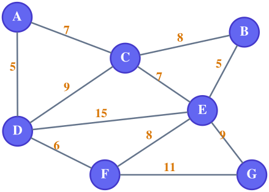
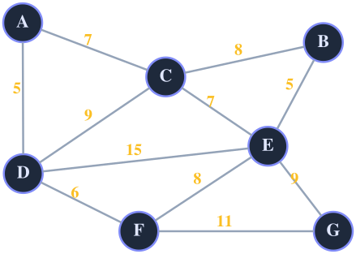

# Graphviz Diagrams (Light + Dark Mode)

Write diagrams as `.dot` files. A GitHub Action renders them to transparent SVGs, and your Markdown shows the SVGs.




> [!NOTE]
> The image above switches automatically with the viewer's GitHub theme. See **How to use** below.

---

## Project structure

```
graphviz-diagrams/
├── .github/workflows/render-graphviz.yml   # the GitHub Action
├── dot/                                     # EDIT THESE (source files)
│   ├── graph-light.dot
│   ├── graph-dark.dot
│   └── graph-neutral.dot
├── diagrams/                                # GENERATED SVGs (do not edit)
│   ├── graph-light.svg
│   ├── graph-dark.svg
│   └── graph-neutral.svg
├── docs/cheatsheet.md                       # color palettes and style tokens
└── README.md
```

| File            | Best for                                            |
| --------------- | --------------------------------------------------- |
| `graph-light`   | Light backgrounds                                   |
| `graph-dark`    | Dark backgrounds                                    |
| `graph-neutral` | Works on both (solid indigo nodes, mid-tone colors) |

---

## How the automation works

1. You edit a file in `dot/` and push.
2. The Action runs `dot -Tsvg` on every `dot/*.dot` file.
3. It commits the results to `diagrams/<same-name>.svg`.
4. Your Markdown shows the SVG.

The Action only runs when files in `dot/` change, so its own commits never trigger it again. You can also run it manually from the **Actions** tab (**Render Graphviz diagrams → Run workflow**).

---

## How to use

### Option A: Both modes (recommended)

Shows the light diagram to light-theme viewers and the dark diagram to dark-theme viewers.

**Markdown only (GitHub):**

```markdown


```

**With `<picture>` (works on GitHub and most other renderers):**

```html
<picture>
  <source
    media="(prefers-color-scheme: dark)"
    srcset="diagrams/graph-dark.svg"
  />
  
</picture>
```

### Option B: Light mode only

```markdown

```

You can delete `dot/graph-dark.dot` and `dot/graph-neutral.dot` if you don't need them.

### Option C: Dark mode only

```markdown

```

You can delete `dot/graph-light.dot` and `dot/graph-neutral.dot` if you don't need them.

### Option D: One image for both themes

Use the neutral version. It has a single file and a single line, and stays readable on light and dark pages.

```markdown

```

> If you delete a `.dot` file, also delete its matching SVG from `diagrams/`. The Action does not remove old SVGs.

---

## Add your own diagram

1. Copy `dot/graph-light.dot` to `dot/my-diagram-light.dot` and `dot/graph-dark.dot` to `dot/my-diagram-dark.dot`.
2. Change the nodes and edges. Keep the color lines for each theme.
3. Push. The Action creates `diagrams/my-diagram-light.svg` and `diagrams/my-diagram-dark.svg`.
4. Reference them with Option A, B, C or D above.

### Change colors

Edit the hex codes at the top of each `.dot` file (`fillcolor`, `color`, `fontcolor`). Ready-made palettes (Indigo, Emerald, Mono, Rose) are in `docs/cheatsheet.md`.

### Highlight a path or MST

```dot
A -- D [xlabel="5", color="#dc2626", penwidth=4];
```

---

## Preview locally (optional)

Install Graphviz, then:

```bash
dot -Tsvg dot/graph-light.dot -o diagrams/graph-light.svg
```

Or paste a `.dot` file into <https://dreampuf.github.io/GraphvizOnline>

---

## Troubleshooting

| Problem                                    | Fix                                                                                                                                         |
| ------------------------------------------ | ------------------------------------------------------------------------------------------------------------------------------------------- |
| Image is broken right after the first push | Wait a minute for the Action to finish, then refresh. The SVGs are also included in this project, so this only happens if you removed them. |
| Action fails with a permission error       | Go to **Settings → Actions → General → Workflow permissions** and select **Read and write permissions**.                                    |
| Action never runs                          | Check that the `.github` folder uploaded. It is hidden on some systems. Also check that Actions is enabled in the repo's **Actions** tab.   |
| Edited a `.dot` but the SVG didn't change  | Make sure the file is inside `dot/`, and check the **Actions** tab for errors.                                                              |
| Weights hard to read                       | Raise `fontsize` in the `edge` line, or switch `xlabel` to `label` to put the weight on the line.                                           |
