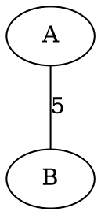

# Graphviz in Markdown (Inline, Light + Dark)

Write Graphviz code **inside your Markdown file**. There are no `.dot` files and no `.svg` files. The only file you edit is your `.md`.

See the working example in [`diagrams.md`](diagrams.md).

---

## Why a renderer is needed

GitHub can draw Mermaid blocks natively, but it cannot draw Graphviz, and it strips inline SVG and `data:` images from Markdown. So without any image files, the picture has to come from a rendering service.

This project uses **Kroki** (kroki.io). The image URL contains your compressed dot code, and Kroki returns an SVG when the page loads. A GitHub Action keeps those URLs up to date, so you never have to encode anything by hand.

---

## Project structure

```
graphviz-diagrams/
├── .github/
│   ├── workflows/update-graphviz-urls.yml   # the GitHub Action
│   └── scripts/update_urls.py               # builds the image URLs
├── diagrams.md                              # EDIT THIS: inline dot code
├── docs/cheatsheet.md                       # color palettes and style tokens
└── README.md                                # this guide
```

---

## How it works

1. You edit a `dot` block in `diagrams.md` and push.
2. The Action finds every block whose **first line** is `// graphviz: NAME`.
3. It rewrites the matching line `[NAME]: https://kroki.io/graphviz/svg/...` at the bottom of the file.
4. Your image line `![Weighted graph][NAME]` shows the diagram.

The Action's own commit does not trigger it again, because commits made with the built-in token don't start new workflow runs. You can also run it manually from the **Actions** tab.

---

## The block syntax

Each diagram needs two things: an image line, and a source block. The URL line is added and maintained for you.

````markdown
![My graph][my-graph]

> [!NOTE]
> **Source**
>
> ```dot
> // graphviz: my-graph
> graph G {
>     A -- B [label=5];
> }
> ```
````

After the first run, the Action adds this to the bottom of the file:

```
[my-graph]: https://kroki.io/graphviz/svg/eNqV...
```

A plain code block works too, if you don't want the callout:

````markdown

````

Rules:

- The first line inside the block must be exactly `// graphviz: NAME`. Use letters, numbers, `-` and `_` only.
- Each name must be unique within a file.
- The image line must use the same name: `![alt][NAME]`.
- `README.md` and everything in `docs/` are skipped, because they contain syntax examples. To change this, edit `SKIP_FILES` and `SKIP_DIRS` in `update_urls.py`.

---

## How to use: one mode or both

`diagrams.md` contains three versions of the same graph:

| Name | Best for |
|---|---|
| `graph-light` | Light backgrounds |
| `graph-dark` | Dark backgrounds |
| `graph-neutral` | Both (solid indigo nodes, mid-tone colors) |

Names ending in `-light` or `-dark` automatically get GitHub's `#gh-light-mode-only` or `#gh-dark-mode-only` suffix on their URL line. This is what makes GitHub show the right one for each viewer.

### Both modes (recommended)

Keep the `graph-light` and `graph-dark` blocks, and use both image lines:

```markdown
![My graph][graph-light]
![My graph][graph-dark]
```

### Light mode only

Keep only the `graph-light` block. Rename it to `graph-main` (no `-light` suffix) so the suffix isn't added, and use:

```markdown
![My graph][graph-main]
```

### Dark mode only

Same idea: keep only the dark block, rename it to `graph-main` (no `-dark` suffix), and use:

```markdown
![My graph][graph-main]
```

### One image for both themes

Keep only the `graph-neutral` block, and use:

```markdown
![My graph][graph-neutral]
```

> Delete the unused blocks **and** their `[name]: https://...` lines at the bottom of the file.

---

## Add your own diagram

1. Copy a block in `diagrams.md` (or create a new `.md` file anywhere except `README.md` and `docs/`).
2. Change the name on the first line, and edit the nodes and edges.
3. Add an image line, `![alt][name]`.
4. Push. The Action adds the `[name]: ...` URL line within a minute.

For two themes, make two blocks with matching names such as `my-graph-light` and `my-graph-dark`.

### Change colors

Edit the hex codes in `fillcolor`, `color`, `fontcolor` and the `edge` line. Ready-made palettes are in `docs/cheatsheet.md`.

---

## Things to know

- **Third-party service.** Your dot code is sent to kroki.io whenever someone views the page. Don't use this for confidential diagrams. For private use, self-host Kroki with Docker (`yuzutech/kroki`) and set `KROKI_BASE` at the top of `update_urls.py`.
- **Needs internet.** If kroki.io is down or blocked, the images won't load.
- **URL length.** The graph in this project uses about 525 characters. Very large graphs (several thousand characters) may hit URL limits. Split them or self-host Kroki.
- **Not visible outside GitHub.** Many local Markdown previewers show these images fine, but offline ones will not.
- **Prefer no external service?** Use Mermaid, which GitHub renders natively. The layout is automatic, so it won't match exact node positions.

---

## Preview locally (optional)

Run from the project root:

```bash
python3 .github/scripts/update_urls.py
```

This updates the URL lines in your Markdown files. No Graphviz install is needed.

---

## Troubleshooting

| Problem | Fix |
|---|---|
| Image is broken right after a push | Wait a minute for the Action to finish, then run `git pull` and refresh. |
| Action fails with a permission error | Go to **Settings → Actions → General → Workflow permissions** and select **Read and write permissions**. |
| Action never runs | Check that the hidden `.github` folder uploaded, and that Actions is enabled in the **Actions** tab. |
| No URL line was added | The first line inside the block must be exactly `// graphviz: NAME`, with no blank line before it. |
| Image shows an error from Kroki | There is a syntax error in the dot code, such as a missing `;` or an unclosed quote. Test the code at https://dreampuf.github.io/GraphvizOnline. |
| Block inside a callout is ignored | Keep the `>` on every line, including blank lines. |
| Both light and dark images show at once | The name must end in `-light` or `-dark`, or the URL line must end in `#gh-light-mode-only` or `#gh-dark-mode-only`. |
