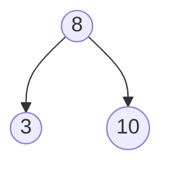

# DSA Notes

Diagram setup for data structures and algorithms notes.

| Topic | Tool | Notes file |
|---|---|---|
| Trees | **Mermaid** (inline, rendered natively by GitHub) | [`notes/trees.md`](notes/trees.md) |
| Graphs | **Graphviz** (`.dot` files rendered to `.svg` by GitHub Actions) | [`notes/graphs.md`](notes/graphs.md) |

Palettes and syntax are in [`docs/cheatsheet.md`](docs/cheatsheet.md).

---

## Project structure

```
dsa-notes/
├── .github/workflows/render-graphviz.yml   # renders .dot to .svg
├── diagrams/
│   ├── dot/                                # EDIT: Graphviz sources
│   │   ├── graph-light.dot
│   │   ├── graph-dark.dot
│   │   ├── mst-light.dot
│   │   └── mst-dark.dot
│   └── svg/                                # CREATED by the Action (not in the zip)
├── notes/
│   ├── trees.md                            # Mermaid diagrams
│   └── graphs.md                           # Graphviz images
├── docs/cheatsheet.md
└── README.md
```

---

## Trees with Mermaid

Write the diagram directly in a `mermaid` code block. GitHub renders it in the preview, and no other setup is needed.

````markdown

````

---

## Graphs with Graphviz

### How it works

1. You edit a file in `diagrams/dot/` and push.
2. The Action runs `dot -Tsvg` on every `.dot` file.
3. It commits the results to `diagrams/svg/<same-name>.svg`.
4. Your notes show the SVG through a normal image line.

The Action runs on every push, and only commits when an SVG actually changed. Its own commits never trigger it again. It also deletes any SVG whose `.dot` file has been removed. You can run it manually from the **Actions** tab.

### Use light mode, dark mode, or both

Each graph has a `-light` and a `-dark` file.

**Both modes (recommended).** Viewers see the version that matches their GitHub theme:

```markdown


```

**Light only:**

```markdown

```

**Dark only:**

```markdown

```

If you only need one mode, you can delete the other `.dot` file. The Action removes its SVG on the next run.

Adjust `../` to match where your Markdown file sits. From the project root it is `diagrams/svg/...`, and from a file inside `notes/` it is `../diagrams/svg/...`.

### Add a new graph

1. Copy `diagrams/dot/graph-light.dot` to `diagrams/dot/my-graph-light.dot`, and the dark one to `my-graph-dark.dot`.
2. Edit the nodes, edges and weights.
3. Add the two image lines to your notes, pointing at `my-graph-light.svg` and `my-graph-dark.svg`.
4. Push. The SVGs appear after the Action finishes.

### Highlight an edge (MST, shortest path)

Add a color and thicker line to the edge:

```
A -- D [xlabel="5", color="#dc2626", penwidth=4];
```

For step-by-step algorithms, copy the files per step (`prim-step1-light.dot`, `prim-step2-light.dot`, ...). All steps keep the same node positions.

---

## Setup

1. Create a new empty repo on GitHub.
2. Upload the **contents** of this folder, including the hidden `.github` folder.
3. Go to **Settings → Actions → General → Workflow permissions** and select **Read and write permissions**.
4. Open `notes/graphs.md` and `notes/trees.md` to check the preview.

The `diagrams/svg/` folder is not included. The Action creates it on the first run, so the graph images appear once that run finishes (usually under a minute).

### Preview locally (optional)

```bash
dot -Tsvg diagrams/dot/graph-light.dot -o diagrams/svg/graph-light.svg
```

---

## Troubleshooting

### SVGs are not generated

Work through these in order:

0. **Is the project at the repo root?** The repo's main page must show `.github`, `diagrams` and `notes` directly. If it shows a single `dsa-notes` folder instead, you uploaded the folder rather than its contents, and GitHub ignores workflows inside subfolders. Move the contents up to the root.
1. **Is the workflow there?** Open the repo's **Actions** tab. You should see **Render Graphviz diagrams** in the left sidebar. If it is missing, the hidden `.github` folder was not uploaded. Upload it again, or use `git push`.
2. **Is Actions enabled?** If the tab says workflows are disabled, click **Enable**. Forked repos have Actions turned off by default.
3. **Did a run happen?** If there is no run after your push, click **Run workflow** (top right of the workflow page) to start one manually.
4. **Did it fail?** Open the run. A red failure at **Commit and push rendered SVGs** with a permission error means you need to go to **Settings → Actions → General → Workflow permissions** and select **Read and write permissions**, then click **Re-run all jobs**.
5. **Is the branch protected?** Branch protection rules can block the bot's commit. Allow GitHub Actions to push, or render locally (below).
6. **Did it succeed but show no new commit?** Then the SVGs were already up to date, because the output matched what was committed.
7. **Are you looking at your local copy?** The Action commits on GitHub, so run `git pull` to get the new SVGs.

### Other problems

| Problem | Fix |
|---|---|
| Image is broken after a push | Wait a minute for the Action to finish, then refresh. |
| Edited a `.dot` file but nothing changed | The file must be inside `diagrams/dot/` and end in `.dot`. Check the run log for a Graphviz syntax error. |
| Image path is wrong | Check the `../` depth against the Markdown file's location. |
| Both light and dark images show at once | The URL must end in `#gh-light-mode-only` or `#gh-dark-mode-only`. |
| Mermaid shows an error | Check for unclosed brackets and make sure node IDs have no spaces. |

### Fallback: render locally

If you can't get the Action working, install Graphviz and run this from the project root, then commit the SVGs:

```bash
for f in diagrams/dot/*.dot; do dot -Tsvg "$f" -o "diagrams/svg/$(basename "$f" .dot).svg"; done
```
