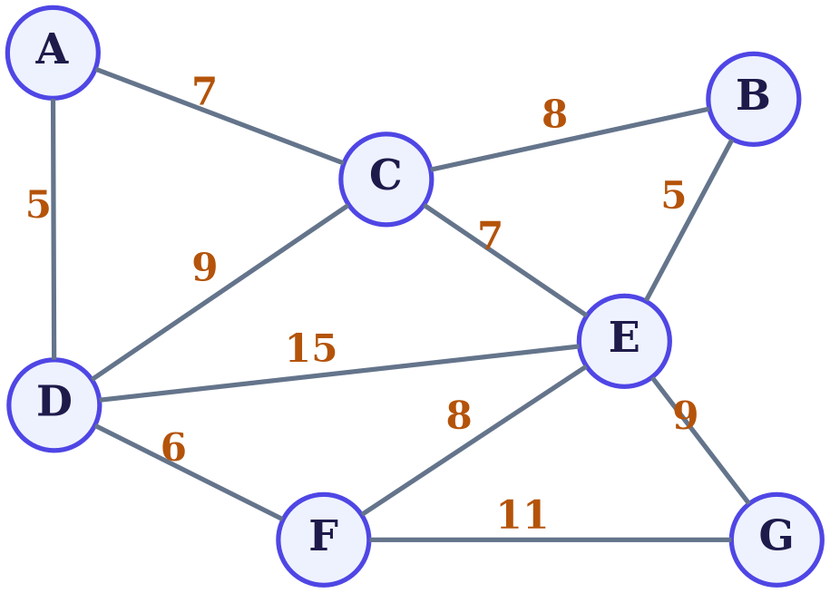
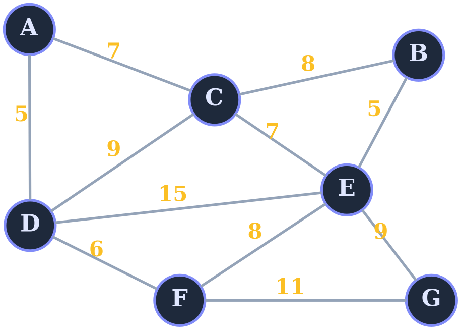

# Graphviz Diagram Cheatsheet (Transparent BG, Light + Dark)

A minimal, attractive style system for weighted graphs. All diagrams use a **transparent background**, so they blend into any page.

---

## 1. Color Palettes

Pick one preset. Each has a light and a dark variant.

### Indigo (default, clean and modern)

| Element | Light | Dark |
|---|---|---|
| Node fill | `#eef2ff` | `#1e293b` |
| Node border | `#4f46e5` | `#818cf8` |
| Node text | `#1e1b4b` | `#e0e7ff` |
| Edge line | `#64748b` | `#94a3b8` |
| Weight text | `#b45309` | `#fbbf24` |
| Highlight (MST/path) | `#dc2626` | `#f87171` |

### Emerald (fresh, calm)

| Element | Light | Dark |
|---|---|---|
| Node fill | `#ecfdf5` | `#022c22` |
| Node border | `#059669` | `#34d399` |
| Node text | `#064e3b` | `#d1fae5` |
| Edge line | `#6b7280` | `#9ca3af` |
| Weight text | `#c2410c` | `#fcd34d` |
| Highlight (MST/path) | `#dc2626` | `#fb7185` |

### Mono (ultra minimal, print friendly)

| Element | Light | Dark |
|---|---|---|
| Node fill | `#ffffff` | `#111827` |
| Node border | `#111827` | `#f3f4f6` |
| Node text | `#111827` | `#f3f4f6` |
| Edge line | `#6b7280` | `#9ca3af` |
| Weight text | `#374151` | `#d1d5db` |
| Highlight (MST/path) | `#dc2626` | `#f87171` |

### Rose (warm, soft)

| Element | Light | Dark |
|---|---|---|
| Node fill | `#fff1f2` | `#2a0a14` |
| Node border | `#e11d48` | `#fb7185` |
| Node text | `#4c0519` | `#ffe4e6` |
| Edge line | `#78716c` | `#a8a29e` |
| Weight text | `#0369a1` | `#38bdf8` |
| Highlight (MST/path) | `#7c3aed` | `#c4b5fd` |

---

## 2. Style Tokens

| Property | Value | Why |
|---|---|---|
| Background | `bgcolor=transparent` | Blends into any page |
| Node shape | `circle`, `fixedsize=true`, `width=0.66` | Uniform, tidy circles |
| Node border width | `penwidth=2.5` | Visible but not heavy |
| Edge width | `penwidth=2.5` | Matches the node border |
| Highlight width | `penwidth=4` | Stands out clearly |
| Node font | `Times-Bold`, size `22` | Classic graph-theory look |
| Weight font | `Times-Bold`, size `20` | Slightly smaller than node text |
| Modern font alternative | `Helvetica-Bold` or `Inter` | Cleaner, sans-serif look |
| Layout engine | `neato` with `pos="x,y!"` | Pins nodes to exact positions |
| Label placement | `xlabel` + `forcelabels=true` | Weights sit beside edges, not on them |
| Label on the line | use `label` instead of `xlabel` | Weight sits on the edge itself |

---

## 3. Light Mode Code

Save as `graph-light.dot`:



## 4. Dark Mode Code

Save as `graph-dark.dot`. Only the colors change:



---

## 5. Reusable Template

Replace the `<...>` values with colors from any palette above:

```dot
node [shape=circle, fixedsize=true, width=0.66,
      fontname="Times-Bold", fontsize=22, style=filled,
      fillcolor="<NODE_FILL>", color="<NODE_BORDER>",
      fontcolor="<NODE_TEXT>", penwidth=2.5];
edge [color="<EDGE>", penwidth=2.5,
      fontname="Times-Bold", fontsize=20, fontcolor="<WEIGHT>"];
```

---

## 6. Highlighting a Path or MST

Add `color` and a thicker `penwidth` to the edge. Use the **Highlight** color from your palette.

```dot
// Light mode
A -- D [xlabel="5", color="#dc2626", penwidth=4];

// Dark mode
A -- D [xlabel="5", color="#f87171", penwidth=4];
```

To highlight a node too (for example, a start node):

```dot
A [pos="1.21,4.35!", color="#dc2626", penwidth=4];
```

---

## 7. Rendering

```bash
# SVG (recommended: sharp and transparent)
neato -Tsvg graph-light.dot -o graph-light.svg
neato -Tsvg graph-dark.dot  -o graph-dark.svg

# PNG with transparent background
neato -Tpng -Gdpi=200 graph-light.dot -o graph-light.png
neato -Tpng -Gdpi=200 graph-dark.dot  -o graph-dark.png
```

No install needed: paste the code into **dreampuf.github.io/GraphvizOnline**.

---

## 8. Embedding in Markdown (Auto Light/Dark Switching)

### GitHub (recommended)

```markdown


```

### Any renderer that supports HTML

```html
<picture>
  <source media="(prefers-color-scheme: dark)" srcset="graph-dark.svg">
  
</picture>
```

### Single file only

```markdown

```

---

## 9. Quick Tips

- **Contrast first.** On a transparent background, text must be readable on both white and near-black pages. Mid-tone edge colors such as `#64748b` and `#94a3b8` work on both.
- **Keep it minimal.** Use one accent color for weights and one for highlights, and avoid more.
- **Weights unreadable?** Increase `fontsize` or switch `xlabel` to `label`.
- **Nodes overlapping labels?** Lower `width` (node size) or move the node's `pos`.
- **Position units** are inches: `pos="x,y!"`. The `!` pins the node, and the origin is at the bottom-left.
- **Undirected vs directed:** use `graph` with `--` for undirected, and `digraph` with `->` for directed.
