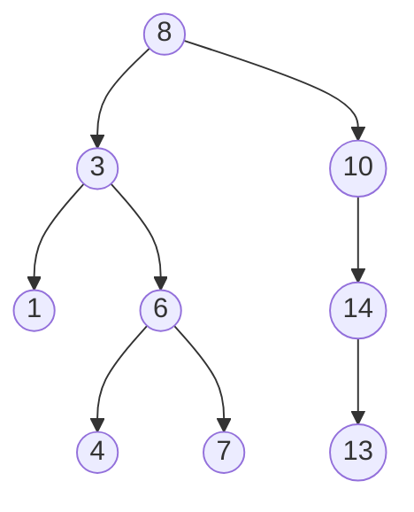
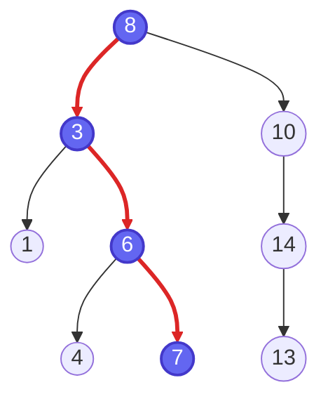

# Trees (Mermaid)

GitHub draws Mermaid natively and adapts it to the viewer's light or dark theme. The code lives right in this file.

## Binary search tree

| Traversal | Result |
|---|---|
| Inorder (L, Root, R) | 1, 3, 4, 6, 7, 8, 10, 13, 14 |
| Preorder (Root, L, R) | 8, 3, 1, 6, 4, 7, 10, 14, 13 |
| Postorder (L, R, Root) | 1, 4, 7, 6, 3, 13, 14, 10, 8 |

## Search path for 7

The visited nodes and edges are highlighted: `8 → 3 → 6 → 7`.

> [!TIP]
> `linkStyle` numbers count edges in the order they are written, starting at 0. Here edge 0 is `8 → 3`, edge 3 is `3 → 6`, and edge 6 is `6 → 7`.
